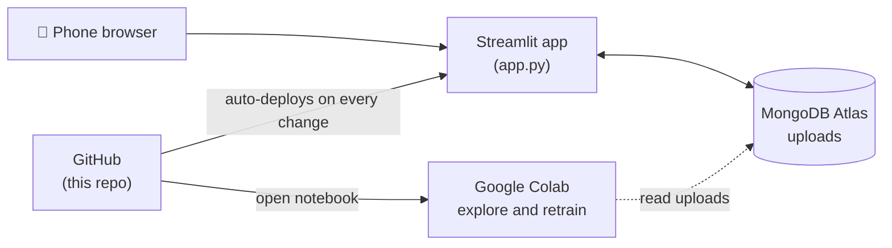
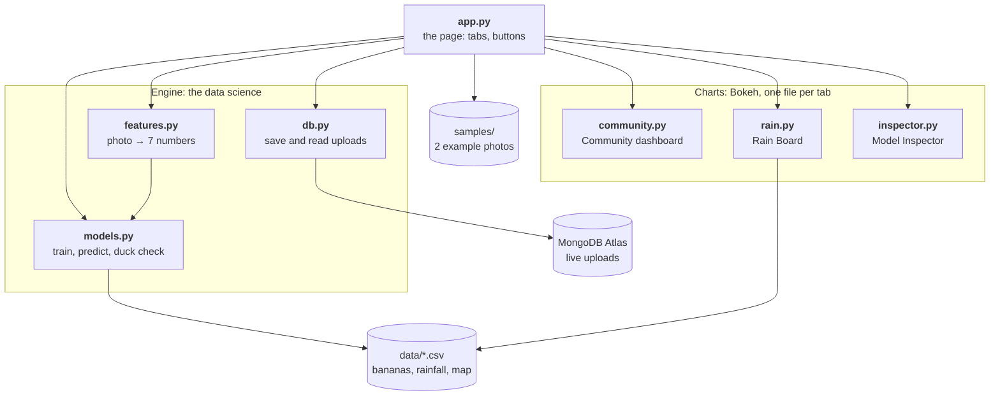

# 🍌 FasalScope

**Photo → numbers → models → decision.** A small, complete data-science product: check whether a banana is ripe from a photo, see everyone's uploads on a live dashboard, explore 115 years of Indian rainfall on a map, and drag sliders to see how machine-learning models make (and miss) decisions.

Built by **Dr. Nilesh P. Ingle** for the course *1MTAIDS 33 Data Science* (Department of Applied Electronics, Sant Gadge Baba Amravati University, Amravati).
[LinkedIn](https://www.linkedin.com/in/nileshingle/)

| | |
|---|---|
| ▶ **Live app** | **[fasalscope.streamlit.app](https://fasalscope.streamlit.app/)** (if it shows "This app has gone to sleep", click the button and wait about a minute) |
| ▶ **Look under the hood in Colab** | [](https://colab.research.google.com/github/learndataa/fasalscope/blob/main/notebooks/FasalScope_under_the_hood.ipynb) |
| ▶ **Build it yourself** | **Code → Download ZIP**, then follow [the step-by-step guide](#download-the-zip-and-build-it-yourself-step-by-step) |
| ▶ **Make your own online copy** | **Use this template** or **Fork** (top right), then [deploy it on Streamlit](#deploy-your-own-copy-free) |

---

## What's inside

| Tab | What it does | Course idea |
|---|---|---|
| **Check a banana** | Upload or snap a photo; three models say ripe or unripe | features, SVM, Naive Bayes, logistic regression |
| **Community dashboard** | Everyone's uploads as stars on a Bokeh chart, with the SVM "road" | MongoDB, linked Bokeh views, hover tooltips |
| **Rain Board** | IMD rainfall 1901–2015: map, 115-year trend, monsoon months | statistics, honest encodings, Bokeh maps |
| **Model Inspector** | Threshold slider with confusion matrix and ROC; overfitting slider | evaluation, train/test split, overfitting |

## How the pieces connect



## How the code fits together

`app.py` is only the page. It never does the data science itself: it asks the other files for answers and puts them on screen. **One file per job**, so you can change one without breaking the others.



### The journey of one banana photo

| Step | File | Call | What comes back |
|---|---|---|---|
| 1 | `app.py` | `st.file_uploader` / `st.camera_input` | the photo |
| 2 | `features.py` | `extract(photo)` | 7 numbers: % green, % yellow, % brown, hue, saturation, brightness, roundness (+ a tiny thumbnail) |
| 3 | `models.py` | `predict(T, feats)` | P(ripe) from SVM, Naive Bayes and logistic regression |
| 4 | `models.py` | `T.familiar.check(feats)` | "does this even look like a banana?" (the duck check) |
| 5 | `db.py` | `make_record(...)` → `STORE.add(...)` | saved to MongoDB (or temporary memory) |
| 6 | `community.py` | `dashboard(...)` | the new upload appears as a star on the Bokeh chart |

### When does each part run?

- **Once, when the app starts** (then remembered with `@st.cache_resource`): `models.train()` reads `data/banana_features.csv` and trains all three models plus the duck check in under a second; `db.get_store()` connects to MongoDB.
- **On every click or upload:** Streamlit re-runs `app.py` from top to bottom, reusing the trained models and the database connection.
- **Only in your browser:** the sliders in the Model Inspector are small JavaScript functions (`CustomJS`) inside the Bokeh charts, so dragging them never talks to the server.

### Every file

| File | Job |
|---|---|
| `app.py` | the page: tabs, photo upload, calls everything else |
| `features.py` | photo → 7 numbers (6 colour numbers for ripeness + roundness for the duck check) |
| `models.py` | trains SVM, Naive Bayes, logistic regression and the "is it a banana?" check when the app starts |
| `db.py` | saves and reads uploads (MongoDB if configured, otherwise temporary memory) |
| `community.py`, `rain.py`, `inspector.py` | the Bokeh charts for each tab |
| `build_dataset.py` | one-time tool: turns a folder of labelled photos into `data/banana_features.csv` (the app never runs it) |
| `notebooks/` | the Colab notebook; it imports the **same files** as the app |
| `data/`, `samples/` | training numbers, rainfall, map positions, two example photos (credits in `data/README.md`) |
| `.streamlit/` | app settings and the secrets *template* (the real secret lives only in Streamlit's settings) |
| `.devcontainer/` | added by Streamlit; only used if you open the repo in GitHub Codespaces |

## Download the ZIP and build it yourself (step by step)

No git and no GitHub account needed. About 15 minutes the first time.

### Step 1 · Install Python (once)
- Download **Python 3.12** from [python.org/downloads](https://www.python.org/downloads/).
- **Windows:** on the first installer screen, tick **"Add python.exe to PATH"**, then click *Install Now*.
- **Mac:** run the installer, then open the *Python 3.12* folder in Applications and double-click **Install Certificates.command**.
- Check it worked: open a terminal (Windows: *Command Prompt*; Mac: *Terminal*) and type `python --version` (Mac: `python3 --version`). You should see `Python 3.12.x`.

### Step 2 · Download the code
1. On this page, click the green **Code** button → **Download ZIP**.
2. Unzip it (Windows: right-click → *Extract All*; Mac: double-click). You get a folder called `fasalscope-main`.

### Step 3 · Open a terminal inside that folder
- **Windows:** open the `fasalscope-main` folder, click the address bar, type `cmd` and press Enter.
- **Mac:** right-click the folder → *New Terminal at Folder* (or type `cd ` in Terminal and drag the folder in).

### Step 4 · Make a private Python space and install the packages
A *virtual environment* keeps this project's packages separate from everything else on your computer.

| | Windows | Mac / Linux |
|---|---|---|
| create it (once) | `python -m venv .venv` | `python3 -m venv .venv` |
| switch it on (every time) | `.venv\Scripts\activate` | `source .venv/bin/activate` |
| install packages (once, 2–5 min) | `pip install -r requirements.txt` | `pip install -r requirements.txt` |

When it is switched on, your prompt starts with `(.venv)`.

### Step 5 · Run the app
```bash
streamlit run app.py
```
Your browser opens **http://localhost:8501** with FasalScope running on your own computer. Stop it with **Ctrl + C** in the terminal.
Without a database, uploads are kept only until you stop the app; everything else works.

### Step 6 · Change something and watch it update
Open `app.py` in any editor (VS Code, Notepad, IDLE), change the title in `st.title("🍌 FasalScope")`, save, and click **Rerun** in the browser. Ideas to try:
- add a model to `make_models()` in `models.py` (for example `KNeighborsClassifier`);
- add a seventh colour number in `features.py`;
- change the region list or colours in `rain.py`.

### Step 7 *(optional)* · Keep uploads in your own MongoDB
1. Create a free **MongoDB Atlas** M0 cluster, a database user (letters and numbers in the password) and allow network access.
2. In the project folder, copy `.streamlit/secrets.toml.example` to `.streamlit/secrets.toml` and paste your connection string between the quotes.
3. Run `streamlit run app.py` again: the *Community dashboard* tab should say **Connected to MongoDB Atlas**.
`secrets.toml` is listed in `.gitignore`, so it is never uploaded to GitHub.

### Step 8 *(optional)* · Retrain on the photos yourself
1. Download the *Ripe Unripe Banana Dataset* from [Mendeley Data](https://data.mendeley.com/datasets/y3649cmgg6/1) (CC BY 4.0) and unzip it, including the `banana_data.zip` inside.
2. Run `python build_dataset.py PATH/TO/data_banana` (about 15 seconds for 1,340 photos). It rewrites `data/banana_features.csv`.
3. Restart the app: the models retrain on your new numbers automatically.

### Step 9 *(optional)* · Put your version online
1. Create a free GitHub account and a new **public** repository.
2. On the repository page: **Add file → Upload files**, drag in everything from your folder **except** `.venv` and `.streamlit/secrets.toml`, then **Commit changes**.
3. Follow **Deploy your own copy** below. You now have your own link for your portfolio; please keep the credit line (MIT licence).

### If something goes wrong
| Message | Fix |
|---|---|
| `'python' is not recognized` (Windows) | Python is not on PATH: reinstall and tick **Add python.exe to PATH**, or try `py` instead of `python`. |
| `command not found: python` (Mac) | Use `python3` and `pip3`. |
| `No module named streamlit` | The virtual environment is off: run the *switch it on* command from step 4, then try again. |
| `Port 8501 is already in use` | Another copy is running: close it, or run `streamlit run app.py --server.port 8502`. |
| *Couldn't reach MongoDB* on the dashboard | Check the password in `secrets.toml`, and that Atlas *Network Access* allows your IP. The app still works without it. |

## Deploy your own copy (free)

1. **Use this template** (or **Fork**) → create your repository. (Or upload the files yourself: step 9 above.)
2. Go to **share.streamlit.io**, sign in with GitHub, **Create app** → your repository, branch `main`, file `app.py`.
3. *(Optional, to keep uploads)* In **MongoDB Atlas** (free M0 cluster): create a database user, allow network access from `0.0.0.0/0`, copy the connection string. In Streamlit: **App settings → Secrets**, paste
   `MONGO_URI = "mongodb+srv://…"` (see `.streamlit/secrets.toml.example`). **Never commit the real string to GitHub.**

## Honest limits

The models only count colours, so lighting, background and banana variety all change the answer. The training photos show the same bananas many times on the same table, so test accuracy is optimistic (a good classroom example of data leakage). FasalScope is a teaching project, not a certified agricultural tool. Uploads store six numbers, a 96-pixel thumbnail, a first name and the time; please photograph fruit only.

## Credits and licences

- **Code:** MIT licence © 2026 Dr. Nilesh P. Ingle. Reuse freely; keep the copyright notice.
- **Banana photos:** *Ripe Unripe Banana Dataset*, Mendeley Data, CC BY 4.0 (the extracted colour numbers, plus two example photos in `samples/`). See `data/README.md`.
- **Rainfall:** India Meteorological Department subdivision rainfall 1901–2015, published on data.gov.in.
- **Map tiles:** © OpenStreetMap contributors.
