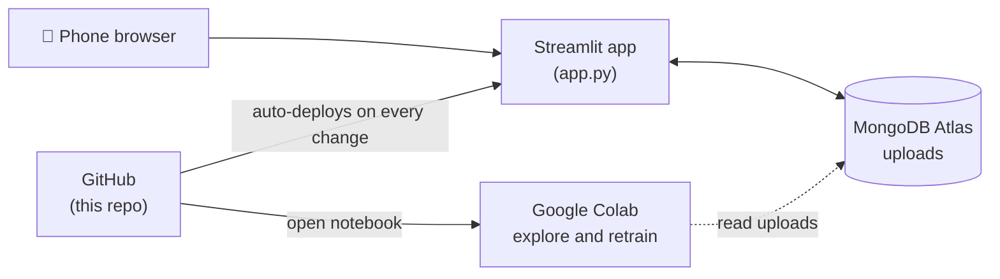
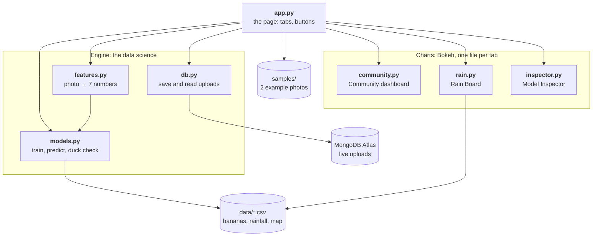

# 🍌 FasalScope

**Photo → numbers → models → decision.** A small, complete data-science product: check whether a banana is ripe from a photo, see everyone's uploads on a live dashboard, explore 115 years of Indian rainfall on a map, and drag sliders to see how machine-learning models make (and miss) decisions.

Built by **Dr. Nilesh P. Ingle** for the course *1MTAIDS 33 Data Science* (Department of Applied Electronics, Sant Gadge Baba Amravati University, Amravati).
[LinkedIn](https://www.linkedin.com/in/nileshingle/)

| | |
|---|---|
| ▶ **Live app** | **[fasalscope.streamlit.app](https://fasalscope.streamlit.app/)** (if it shows "This app has gone to sleep", click the button and wait about a minute) |
| ▶ **Look under the hood in Colab** | [](https://colab.research.google.com/github/learndataa/fasalscope/blob/main/notebooks/FasalScope_under_the_hood.ipynb) |
| ▶ **Make your own copy** | click **Use this template** (top right), then deploy it on Streamlit (steps below) |

---

## What's inside

| Tab | What it does | Course idea |
|---|---|---|
| **Check a banana** | Upload or snap a photo; three models say ripe or unripe | features, SVM, Naive Bayes, logistic regression |
| **Community dashboard** | Everyone's uploads as stars on a Bokeh chart, with the SVM "road" | MongoDB, linked Bokeh views, hover tooltips |
| **Rain Board** | IMD rainfall 1901–2015: map, 115-year trend, monsoon months | statistics, honest encodings, Bokeh maps |
| **Model Inspector** | Threshold slider with confusion matrix and ROC; overfitting slider | evaluation, train/test split, overfitting |

## How the pieces connect



## How the code fits together

`app.py` is only the page. It never does the data science itself: it asks the other files for answers and puts them on screen. **One file per job**, so you can change one without breaking the others.



### The journey of one banana photo

| Step | File | Call | What comes back |
|---|---|---|---|
| 1 | `app.py` | `st.file_uploader` / `st.camera_input` | the photo |
| 2 | `features.py` | `extract(photo)` | 7 numbers: % green, % yellow, % brown, hue, saturation, brightness, roundness (+ a tiny thumbnail) |
| 3 | `models.py` | `predict(T, feats)` | P(ripe) from SVM, Naive Bayes and logistic regression |
| 4 | `models.py` | `T.familiar.check(feats)` | "does this even look like a banana?" (the duck check) |
| 5 | `db.py` | `make_record(...)` → `STORE.add(...)` | saved to MongoDB (or temporary memory) |
| 6 | `community.py` | `dashboard(...)` | the new upload appears as a star on the Bokeh chart |

### When does each part run?

- **Once, when the app starts** (then remembered with `@st.cache_resource`): `models.train()` reads `data/banana_features.csv` and trains all three models plus the duck check in under a second; `db.get_store()` connects to MongoDB.
- **On every click or upload:** Streamlit re-runs `app.py` from top to bottom, reusing the trained models and the database connection.
- **Only in your browser:** the sliders in the Model Inspector are small JavaScript functions (`CustomJS`) inside the Bokeh charts, so dragging them never talks to the server.

### Every file

| File | Job |
|---|---|
| `app.py` | the page: tabs, photo upload, calls everything else |
| `features.py` | photo → 7 numbers (6 colour numbers for ripeness + roundness for the duck check) |
| `models.py` | trains SVM, Naive Bayes, logistic regression and the "is it a banana?" check when the app starts |
| `db.py` | saves and reads uploads (MongoDB if configured, otherwise temporary memory) |
| `community.py`, `rain.py`, `inspector.py` | the Bokeh charts for each tab |
| `build_dataset.py` | one-time tool: turns a folder of labelled photos into `data/banana_features.csv` (the app never runs it) |
| `notebooks/` | the Colab notebook; it imports the **same files** as the app |
| `data/`, `samples/` | training numbers, rainfall, map positions, two example photos (credits in `data/README.md`) |
| `.streamlit/` | app settings and the secrets *template* (the real secret lives only in Streamlit's settings) |
| `.devcontainer/` | added by Streamlit; only used if you open the repo in GitHub Codespaces |

## Run it on your computer

```bash
pip install -r requirements.txt
streamlit run app.py
```
It works without a database (uploads are kept until you stop the app).

## Deploy your own copy (free)

1. **Use this template** → create your repository.
2. Go to **share.streamlit.io**, sign in with GitHub, **Create app** → your repository, branch `main`, file `app.py`.
3. *(Optional, to keep uploads)* In **MongoDB Atlas** (free M0 cluster): create a database user, allow network access from `0.0.0.0/0`, copy the connection string. In Streamlit: **App settings → Secrets**, paste
   `MONGO_URI = "mongodb+srv://…"` (see `.streamlit/secrets.toml.example`). **Never commit the real string to GitHub.**

## Honest limits

The models only count colours, so lighting, background and banana variety all change the answer. The training photos show the same bananas many times on the same table, so test accuracy is optimistic (a good classroom example of data leakage). FasalScope is a teaching project, not a certified agricultural tool. Uploads store six numbers, a 96-pixel thumbnail, a first name and the time; please photograph fruit only.

## Credits and licences

- **Code:** MIT licence © 2026 Dr. Nilesh P. Ingle. Reuse freely; keep the copyright notice.
- **Banana photos:** *Ripe Unripe Banana Dataset*, Mendeley Data, CC BY 4.0 (the extracted colour numbers, plus two example photos in `samples/`). See `data/README.md`.
- **Rainfall:** India Meteorological Department subdivision rainfall 1901–2015, published on data.gov.in.
- **Map tiles:** © OpenStreetMap contributors.
